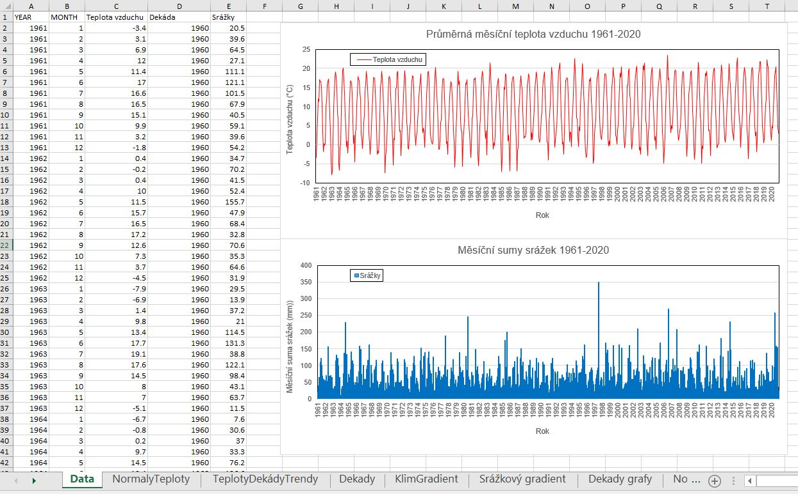
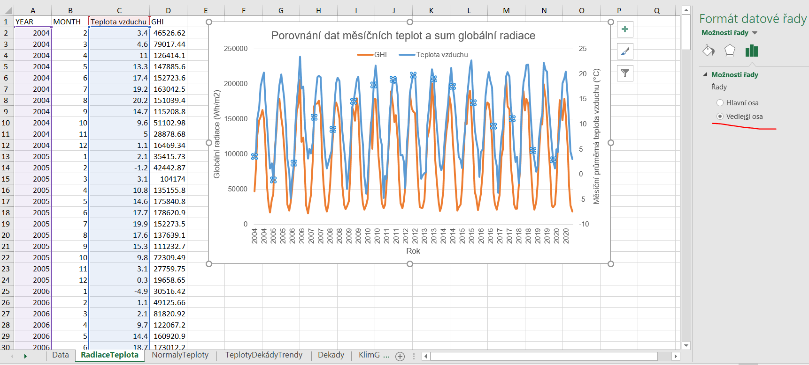
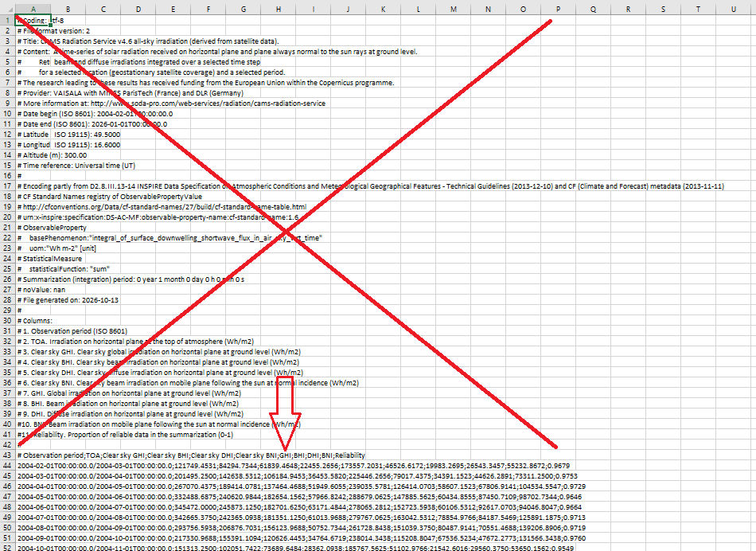

# Základní informace
- Můj kontaktní email je matej.orsag@mendelu.cz, najdete mě v kanceláři N5060 (snažme se ale maximum vyřešit osobně, ve cvičení)
- Na každé cvičení potřebuju notebook (klidně i starý), MS Excel s __dokončenou prací z minulého cvičení__, protože budeme navazovat

## Jak dostanu zápočet
- Splním 3 úkoly:
  - Seminární práce z klimatologie (jeden Excel soubor, viz [Co musí obsahovat odevzdaný soubor](#co-musí-obsahovat-odevzdaný-soubor))
  - Docházka (můžu mít max. 2 absence, přičemž moje nulová aktivita ve cvičení může být považována za absenci, přestože na cvičení fyzicky jsem)
  - Fenologické pozorování v místě bydliště, viz zadání na prvním cvičení

## Co potřebuji pro práci ve cvičení (připravte si dopředu)
- funkční notebook, ideálně i myš
- funkční připojení k internetu, např. univerzitní Wi-Fi EDUROAM ([ZDE najdu jak se připojit](https://eduroam.mendelu.cz/25350-navody-k-instalaci))
- MS Excel ([ZDE najdu jak ho získám](https://tech.mendelu.cz/25346-instalace-baliku-microsoft))

## Co mám dělat když něco nevím nebo nestíhám?
  - Podívám se do [Excel minimum](EXCEL_MINIMUM.md), většina problémů je tam
  - Ptám se přímo na cvičení, od toho tam jsme
  - Ptám se spolužáků
  - Ptám se Googlu nebo AI

## 📘 [Excel minimum](EXCEL_MINIMUM.md)
Všechno, co z Excelu během semestru potřebuju, na jedné stránce: čárky a tečky, vzorce, filtr, kontingenční tabulka, grafy a [jak má vypadat kompletní graf](EXCEL_MINIMUM.md#kompletní-graf). __Přečtu si před prvním cvičením.__

# Zadání seminární práce
Cílem seminární práce je osvojit si základy práce s klimatologickými časovými řadami. V rámci práce budou využita volně dostupná pozorovaná data Českého hydrometeorologického ústavu (ČHMÚ). Data jsou k dispozici v denním či měsíčním časovém kroku.

Kromě práce s pozorovanými daty se rovněž seznámíme s klimatickými scénáři připravenými Ústavem výzkumu globální změny AV ČR, v. v. i. (CzechGlobe). Data budoucích klimatických podmínek jsou k dispozici [zde](https://www.climrisk.cz/mapa-cr/).

## Co musí obsahovat odevzdaný soubor
Jeden soubor __PrijmeniJmeno_Bioklimatologie.xlsx__ s těmito listy (každý graf splňuje [Kompletní graf](EXCEL_MINIMUM.md#kompletní-graf)):

| List | Cvičení | Obsah |
|---|---|---|
| Teplota | 01 | měsíční průměrné teploty (YEAR, MONTH, TAVG) |
| Srazky | 01 | měsíční úhrny srážek (YEAR, MONTH, SRA) |
| TeplotaRadiace | 02 | teplota + GHI, kombinovaný graf |
| NormalyTeploty | 03 | tabulka a graf dvou normálů |
| KlimatickyGradient | 04 | tabulka 10 stanic + bodový graf s rovnicí |
| BudouciKlima | 04 | data ClimRisk + graf |
| TeplotyDekadyTrendy | 05 | dekádní průměry, rozdíly, 6 grafů trendů |
| NormalySrazky | 06 | tabulka a graf dvou normálů |
| DnySnih3cm | 06 | tabulka a graf 4 období |
| SrazkovyGradient | 07 | tabulka 10 stanic + bodový graf s rovnicí |
| SmerVetru | 08 | tabulka četností + větrná růžice |

<!-- POZNÁMKA PRO VYUČUJÍCÍHO: doplnit termín a způsob odevzdání (email / IS / ...) -->

 Cvičení 01 

# Cvičení 01 (týden od 05.10.2026) - Zadání seminární práce z klimatologie, získání dat

- Cílem cvičení je vybrat si stanici se kterou budu v rámci semestru pracovat a získat výchozí data pro další práci
- __Na konci cvičení mám MS Excel soubor se dvěma listy (Teplota a Srazky) s měsíčními daty pro průměrné teploty vzduchu a sumy srážek pro moji vybranou stanici__
- 

## DŮLEŽITÉ ODKAZY ##
- Mapa stanic Českého hydrometeorologického ústavu: [Mapa stanic ZDE](https://www.chmi.cz/namerena-data/umisteni-mericich-stanic/meteorologicke?c=50.0000,15.8258,7.5088&l=kraje,vse,ZTM)
- Metadatový soubor pro vyhledání identifikátoru stanic: [Metadata ZDE](https://opendata.chmi.cz/meteorology/climate/historical_csv/metadata/meta1.csv)
- Datový repozitář ČHMÚ: [Datový repozitář ZDE](https://opendata.chmi.cz/meteorology/climate/historical_csv/data/)
- Převodník CSV souborů na XLSX: [Převodník ZDE](https://milanfischer.github.io/vyuka/csv2xlsx.html)

## Postup získání dat ##

1. Pro práci ve cvičení a na seminární práci vytvořím nový MS Excel soubor, který pojmenuju jako __PrijmeniJmeno_Bioklimatologie.xlsx__ (uložím si ho, vím kde je, budu ho potřebovat každé cvičení, viz [Excel minimum, bod 1](EXCEL_MINIMUM.md#1-kde-je-můj-soubor))

Nyní si potřebuji vybrat nějakou stanici, která má data teploty vzduchu i srážek za celé období posledních dvou klimatických normálů, tzn. 1961-1990 i 1991-2020. S těmito daty budu pracovat po zbytek semestru. Každý student ve cvičení si vybere jinou stanici.

2. Na mapě stanic vyberu stanici [Mapa stanic ZDE](https://www.chmi.cz/namerena-data/umisteni-mericich-stanic/meteorologicke?c=50.0000,15.8258,7.5088&l=kraje,vse,ZTM)
     - 2.1 Na mapě vidím spoustu bodů, každý z nich představuje nějakou meteostanici. V nabídce vpravo "Výběr vrstvy" kliknu na "Teplota" (stanice měřící teplotu obvykle měří i úhrn srážek, takže nejspíš bude mít oboje). Vyberu si bod-stanici, kliknu na něj levým tlačítkem myši a dále rozkliknu "Detail" stanice, což mě přivede na stránku konkrétní stanice.
     - 2.2 Pokud vidím vlevo nahoře vedle záložky "Počasí" také __"Teplota"__ a __"Srážky"__, tak tím mám potvrzeno, že stanice by měla měřit obě tyto proměnné. Teď potřebuji ověřit, zda tato stanice má data teploty i srážek pro celé obě období __1961-1990 a 1991-2020__.
     - 2.3 Kliknu vlevo nahoře na "Historická data", což mě přenese na další stránku, kde vidím tabulku "Dlouhodobé průměry". Pokud v ní jsou hodnoty pro "Průměrná roční teplota vzduchu" i "Průměrný roční úhrn srážek" za obě normálová období 1961-1990 i 1991-2020, mám vyhráno: data z této stanice mají dostatečně dlouhý záznam a můžu je použít.
     - 2.4 Pokud vybraná stanice nemá data v plné délce 1961-1990 a 1991-2020 pro teplotu vzduchu i srážky, vracím se k bodu 2.1 a zkouším najít jinou stanici.
     - 2.5 Vrátím se o úroveň výš a v sekci "Informace o stanici" si poznačím GPS pozici, nadmořskou výšku a ID (kód) stanice, např. P3VLAS01.
     - 2.6 Vybranou stanici nahlásím vyučujícímu

<!-- SCREENSHOT: img/cv01_chmi_historicka_data.png | tabulka Dlouhodobé průměry s oběma normály -->

Pro jistotu to ještě nezávisle ověřím následujícím postupem:
  
3. Stáhnu si z odkazu soubor s metadaty o stanicích [Metadata ZDE](https://opendata.chmi.cz/meteorology/climate/historical_csv/metadata/meta1.csv)
     - 3.1 Otevřu metadatový soubor v MS Excel
     - 3.2 Vyhledám v souboru svou vybranou stanici pomocí ID stanice, které je ve sloupci B. Stisknu __CTRL+F__, vložím do vyhledávacího pole ID stanice a stisknu Enter. Jedna stanice může zabírat několik řádků pod sebou. V každém řádku je uvedeno období, po které stanice měřila: začátek období je ve sloupci C a konec ve sloupci D. Pokud poslední období ve sloupci D končí 3999, znamená to, že stanice měří do současnosti.
     - 3.3 Ověřím, že stanice měří kontinuálně od roku 1961 (případně starší datum). Pokud ne, raději zvolím jinou (jdu na bod 2.1)
     - 3.4 Poznačím si interní kód stanice (sloupec A "WSI")
     - 3.5 Zkontroluju si souřadnice stanice (sloupce F "GEOGR1" a G "GEOGR2") a nadmořskou výšku (sloupec H "ELEVATION"), jestli to sedí s tím, co jsem si poznačil v bodu 2.5

4. Vrátím se na stránky datového repozitáře [Datový repozitář ZDE](https://opendata.chmi.cz/meteorology/climate/historical_csv/data/)
     - 4.1 Volím složku __monthly__
     - 4.2 Budu pracovat se dvěma složkami: __temperature__ a __precipitation__ (postup bude stejný, začnu teplotou)
     - 4.3 Nyní využiji svůj interní kód stanice (_viz body 2.5 nebo 3.4_) a pomocí něj vyhledám příslušné soubory (__CTRL+F__)
     - 4.4 Zajímá mě pouze soubor označený "T" (nezajímá mě: TMA, TMI, TMInoc, TPM) a ten stáhnu
     - 4.5 Zopakuji postup získání dat pro srážky
   
5. Příprava vstupních dat
     - 5.1 __Doporučená cesta:__ stažený CSV soubor nahraju do [převodníku CSV na XLSX](https://milanfischer.github.io/vyuka/csv2xlsx.html), který data rozdělí do sloupců a opraví čísla. Výsledný xlsx soubor otevřu v MS Excel.
     - 5.2 __Záložní cesta__ (když převodník nefunguje): otevřu CSV v MS Excel, na kartě __Data__ zvolím __Text do sloupců__ a nastavím oddělovač (čárka). Pokud Excel převádí čísla na datumy, soubor zavřu bez uložení a nejdřív data upravím podle návodu [Úprava dat v Poznámkovém bloku](#úprava-dat-v-poznámkovém-bloku-windows) níže.
     - 5.3 U teploty vyfiltruju pouze průměrné hodnoty ("AVG" ve sloupci "MDFUNCTION"): výsledkem jsou měsíční hodnoty průměrné teploty vzduchu ve všech letech dostupných pro moji stanici. Jak na filtr: [Excel minimum, bod 5](EXCEL_MINIMUM.md#5-filtr)
     - 5.4 Data ze sloupců C ("YEAR"), D ("MONTH") a G ("VALUE") zkopíruji do svého souboru z __kroku 1__ na první list a ten přejmenuji na __Teplota__ (dvojklik na název listu dole)
     - 5.5 Sloupec "VALUE" přejmenuji na __TAVG__
     - 5.6 Zopakuji postup pro srážky (hodnota "SUM" ve sloupci "MDFUNCTION"), data vložím na nový list __Srazky__ a sloupec "VALUE" přejmenuji na __SRA__

<!-- SCREENSHOT: img/cv01_text_do_sloupcu.png | Data, Text do sloupců, volba oddělovače -->
<!-- SCREENSHOT: img/cv01_filtr_avg.png | filtr ve sloupci MDFUNCTION, zaškrtnuto jen AVG -->

> ✅ __Kontrolní bod (konec cvičení 01):__
> - Mám dva listy: __Teplota__ (YEAR, MONTH, TAVG) a __Srazky__ (YEAR, MONTH, SRA).
> - Každý rok má přesně 12 řádků. Pro období 1961–2020 mám na každém listu minimálně 720 řádků dat (60 let × 12 měsíců).
> - Ve sloupcích s hodnotami nejsou datumy, římské číslice ani text, jen čísla s desetinnou čárkou.
> - Teploty dávají smysl: leden obvykle mezi −8 a +2 °C, červenec obvykle mezi 12 a 21 °C (na horách méně).
> - Srážky nejsou nikdy záporné. Měsíční úhrny jsou obvykle 0 až 200 mm, výjimečně víc (povodně, hory).

6. Bonus
     - 6.1 Z měsíčních dat srážek a teplot si vytvořím jednoduchý spojnicový graf a podívám se na průběh hodnot v čase

### Úprava dat v Poznámkovém bloku (Windows)
Použiju jen tehdy, když nefunguje převodník ani Text do sloupců.
- 1: Najdu si pomocí Průzkumníka souborů stažená data ve formátu CSV
- 2: Pravým tlačítkem myši otevřu na souboru kontextovou nabídku a zvolím "Otevřít v aplikaci" → __Poznámkový blok__
- 3: Zmáčknu současně klávesy __CTRL__ a __H__, otevře se nabídka "Najít a nahradit"
- 4: Nejdříve nahradím všechny čárky (__,__) za středníky (__;__) a dám "Nahradit vše"
- 5: Pak opakuji postup a nahradím všechny tečky (__.__) za čárky (__,__). Pořadí je důležité, nejdřív čárky, pak tečky!
- 6: Uložím soubor (__CTRL + S__) a otevřu ho v MS Excel. Nyní by mělo být vše v pořádku a pokračuju filtrováním dat (bod 5.3)

_Na Macu_ místo Poznámkového bloku použiju TextEdit (Formát → Převést na prostý text) a Najít a nahradit (__CMD + F__), nebo raději převodník.

## Další zdroje:
  - (OS Windows) Klávesové zkratky a mapa znaků pro českou klávesnici: [ZDE](http://www.ceskaklavesnice.cz/zkratky) 

 Cvičení 02 

  
# Cvičení 02 (týden od 12.10.2026) - Radiace a teplota
- Cílem cvičení je vysvětlit si základní terminologii k tématu [slunečního záření (=solární radiace)](https://is.muni.cz/do/rect/el/estud/pedf/ps14/fyz_geogr/web/pages/03-prvky.html), pochopit vztah radiace a teploty vzduchu a otestovat si možnosti získání dat z jiných zdrojů, než je ČHMÚ.
- __Na konci cvičení mám MS Excel soubor s novým listem TeplotaRadiace, kde srovnám měsíční hodnoty solární radiace a teplot pro moji vybranou stanici__

> 💡 __Tip:__ Registraci na Copernicus (bod 2.1) si můžu udělat už před cvičením, ušetřím čas.
  
## DŮLEŽITÉ ODKAZY ##
- [Copernicus](https://www.copernicus.eu/cs) je program Evropské unie pro pozorování Země, který poskytuje bezplatná a systematická data o naší planetě a jejím prostředí prostřednictvím šesti tematických služeb pro širokou škálu uživatelů. Tyto služby monitorují atmosféru, mořské prostředí, pevninu, klima, bezpečnost a krizové situace a poskytují informace pro rozhodování v oblasti politiky, vědy a pro širokou veřejnost, tedy i pro nás. Odtud si stáhnu data globální radiace pro svoji stanici.
- [Data k získání ZDE](https://ads.atmosphere.copernicus.eu/datasets/cams-solar-radiation-timeseries?tab=overview)

## Postup práce ve cvičení ##

1. Ve svém MS Excel souboru __PrijmeniJmeno_Bioklimatologie.xlsx__ vytvořím nový list a pojmenuji ho __TeplotaRadiace__.
    - 1.1 Do prvních 3 sloupců na novém listu nakopíruji data (CTRL+C, CTRL+V) ze sloupců obsahujících __rok, měsíc a hodnoty teploty vzduchu__ z listu __Teplota__.
    - 1.2 Nechám si v listu pouze časovou řadu únor 2004 až prosinec 2025 (ve službě Copernicus jsou data až od února 2004) a zbytek mohu z tohoto listu smazat (__pozor, nesmažu si hodnoty z originálních dat na listu _Teplota___).
    - - 

2. Stahuji data pro solární radiaci ze služby Copernicus
    - 2.1 Na stránkách Copernicus [Data k získání ZDE](https://ads.atmosphere.copernicus.eu/datasets/cams-solar-radiation-timeseries?tab=overview) vyberu záložku __Download__ (MUSÍM SE REGISTROVAT MAILEM, díky čemuž budu moci službu využívat kdykoli v budoucnu)
    - 2.2 Vyplním formulář pro získání dat s pomocí následující nápovědy
    - 2.3 U výběru __Sky type__ volím __Both cloud-free and actual weather conditions__
    - 2.4 Zadám souřadnice své stanice (pokud jsem si minule neopsal souřadnice ze souboru meta1.csv, můžu tak učinit znovu, anebo si je najdu pomocí mapy.com). Na mapě zkontroluju, že jsem souřadnice zadal správně a poloha puntíku cca odpovídá poloze mojí stanice. Pozn.: pokud mě to zaujalo, mohu si analogicky stáhnout data radiace pro libovolný bod v rámci Evropy.
    - 2.5 Zadám nadmořskou výšku své stanice
    - 2.6 Jako rozpětí datumů zvolím __2004-02-01 až 2024-12-31__ (k dispozici jsou data od února 2004 do předvčerejška)
    - 2.7 U výběru __Time step__ volím __1 month__
    - 2.8 U výběru __Time reference__ volím __True solar time__
    - 2.9 U výběru __Data format__ volím __CSV__
    - 2.10 Potvrdím potřebné souhlasy a požádám o data klikem na __Submit form__. Budu pár minut čekat, než se data vygenerují, a pak si je stáhnu. Budou se jmenovat jako změť písmen, např. "3c429be5c399383e3fb1cd2c8a57feb2.csv"
    - 
<!-- SCREENSHOT: img/cv02_copernicus_formular.png | vyplněný formulář Copernicus (Sky type, Time step, Time reference, CSV) -->

3. Práce se staženými daty solární radiace
    - 3.1 Stažený soubor otevřu v MS Excel. Pokud jsou data už rozdělená do sloupců a čísla vypadají správně, body 3.1 a 3.2 přeskočím. Jinak pomocí __CTRL + H__ (__Najít a nahradit__) nahradím čárky středníky (;) a pak tečky čárkami, stejně jako na prvním cvičení s daty z ČHMÚ.
    - 3.2 Použiji trik s rozdělením dat do sloupců (vyberu sloupec _A_ a na kartě _Data_ zvolím _Text do sloupců_), kde mám středník (__;__) jako oddělovač
    - 3.3 Prozkoumám hlavičku souboru (řádky začínající #) a co v ní vše můžu vidět za informace
    - 3.4 Pro další postup budu pracovat s hodnotami __globální radiace__ označenými jako __GHI__. Jednotka je __Wh/m²__ (suma energie, která dopadla na 1 m² vodorovné plochy za daný měsíc). Pro čitelnější čísla si můžu hodnoty vydělit 1000 a dostanu __kWh/m²__.
    - 3.5 Vyberu hodnoty ze sloupců __GHI__ a __Observation period__ a nakopíruji je na připravený list TeplotaRadiace (zkontroluji, zda data mají stejný začátek a konec v čase, a případně si to upravím tak, aby měla)

> ✅ __Kontrolní bod:__
> - Na listu TeplotaRadiace mám __251 řádků dat__ (únor 2004 až prosinec 2024) a v každém řádku sedí měsíc teploty s měsícem radiace.
> - GHI je nejvyšší v létě (květen až červenec), řádově 150 až 190 kWh/m² za měsíc, a nejnižší v prosinci, řádově 15 až 30 kWh/m². Pokud mám čísla úplně jinde, zkontroluju jednotky a jestli jsem nevybral jiný sloupec.

4. Porovnání dat měsíčních teplot a sum globální radiace
    - 4.1 Pro snadné vizuální porovnání hodnot vytvořím spojnicový graf průběhu obou veličin v čase, na kterém si zároveň vyzkouším tvorbu [kompletního grafu](EXCEL_MINIMUM.md#kompletní-graf)
    - 4.2 Na listu TeplotaRadiace vyberu data pro měsíční teploty a globální radiaci
    - 4.3 Vložím spojnicový graf (v Excelu karta __Vložení__)
    - 4.4 Rozdělím obě veličiny na dvě osy: pravý klik na graf → __Změnit typ grafu__ → __Kombinovaný__
    - 4.5 Obě veličiny zobrazím jako spojnicový graf a globální radiaci přesunu na __vedlejší (sekundární) osu__
    - 4.6 Kompletní graf je čitelný a obsahuje minimálně: název, legendu, popisky obou os včetně jednotek (°C a Wh/m² nebo kWh/m²), uvedený zdroj/zdroje dat (ČHMÚ, CAMS/Copernicus)

<!-- SCREENSHOT: img/cv02_kombinovany_graf.png | Změnit typ grafu, Kombinovaný, zaškrtnutá vedlejší osa u GHI -->

## Otázky k zamyšlení ##
1. Ve kterém měsíci je maximum radiace a ve kterém maximum teploty? Proč nejsou ve stejném měsíci?
2. Je vztah mezi radiací a teplotou stejný na jaře a na podzim?

  

 Cvičení 03 

# Cvičení 03 (týden od 19.10.2026) - Srovnání průměrných měsíčních teplot za dvě normálová období
- Cílem cvičení je vytvořit grafy průměrných měsíčních teplot pro dva třicetileté klimatické normály a porovnat hodnoty v těchto obdobích.
- __Na konci cvičení mám MS Excel soubor s novým listem NormalyTeploty, kde srovnám průměrné teploty vzduchu v jednotlivých měsících v rámci dvou klimatických normálů 1961-1990 a 1991-2020, včetně grafického zobrazení__

## Postup práce ve cvičení ##
1. Ve svém MS Excel souboru __PrijmeniJmeno_Bioklimatologie.xlsx__ vytvořím nový list a pojmenuji ho __NormalyTeploty__
   
2. Příprava dat a vytvoření kontingenční tabulky (teplota vzduchu). Obecný návod: [Excel minimum, bod 6](EXCEL_MINIMUM.md#6-kontingenční-tabulka-pivot)
    - 2.1 Na nový list __NormalyTeploty__ nakopíruji data z listu __Teplota__, vyberu pouze časové úseky 1961-1990 a 1991-2020. Hodnoty pro první normál (rok, měsíc, teploty) nakopíruju od sloupce __A__, hodnoty pro druhý normál (rok, měsíc, teploty) od sloupce __E__
    - 2.2 Pokud mi chybí záhlaví (pojmenování sloupců), u obou normálů ho doplním
    - 2.3 Nyní vložím kontingenční graf a kontingenční tabulku. Na kartě __Vložení__ vyberu __Kontingenční graf__ a následně možnost __Kontingenční graf a kontingenční tabulka__ (na MacOS stačí jen __Kontingenční graf__ a pak už rovnou zadávám oblast dat)
    - 2.4 V nabídce __Vybrat tabulku nebo oblast__ vyberu sloupce __A, B, C (data normálu 1961-1990)__ a potvrdím výběr
    - 2.5 Měla by se objevit plátna pro kontingenční tabulku a kontingenční graf (zatím prázdná)
    - 2.6 V nabídce __Pole kontingenčního grafu__ přetáhnu (drag and drop) položku __MONTH__ (nebo odpovídající název mého sloupce s měsícem) do boxu __Osa kategorie__
    - 2.7 Stejným způsobem přetáhnu položku __TAVG__ do boxu __Hodnoty__
    - 2.8 U boxu __Hodnoty__ změním v nabídce __Nastavení polí hodnot...__ funkci na __Průměr__ a potvrdím
    - 2.9 Prohlédnu si vygenerovaný graf a vizuálně zhodnotím, jestli dává smysl (jaké hodnoty jsou na osách X a Y, jestli vidím předpokládaný roční chod teploty atd.). Pokud je vše OK, samotný graf můžu smazat.
    - 2.10 Hodnoty z vygenerované kontingenční tabulky vyberu a pomocí __Vložit hodnoty__ je nakopíruju na volné místo na listu (doporučuju sloupec __I__). Původní kontingenční tabulku smažu.
    - 2.11 Postup tvorby kontingenční tabulky zopakuji pro druhé normálové období

<!-- SCREENSHOT: img/cv03_kontingencni_pole.png | pole kontingenčního grafu, MONTH v Osa kategorie, TAVG v Hodnoty -->
<!-- SCREENSHOT: img/cv03_vlozit_hodnoty.png | Vložit jinak, Hodnoty -->

> ✅ __Kontrolní bod:__
> - Každá z obou tabulek má __12 řádků__ (měsíce 1 až 12), bez řádku „(prázdné)“.
> - Hodnoty jsou průměry ve °C: leden kolem nuly nebo pod nulou, červenec nejteplejší. __Když vidím stovky °C, mám Součet místo Průměru.__
> - Normál 1991-2020 je ve většině měsíců teplejší než 1961-1990.

3. Vytvoření jednoho spojnicového grafu pro porovnání obou normálových období
    - 3.1 Po vytvoření obou tabulek pro období 1961-1990 a 1991-2020 zobrazím obě řady měsíčních průměrných teplot v jednom spojnicovém grafu
    - 3.2 Vyberu vstupní data a pomocí __Vložení → Spojnicový graf__ vložím graf, který dále upravím do podoby [kompletního grafu](EXCEL_MINIMUM.md#kompletní-graf)
    - 3.3 Přidám název, popisy os, zdroj vstupních dat, jednotky, upravím legendu tak, aby byla čitelná (v legendě „1961–1990“ a „1991–2020“, ne „Řada1“)

## Otázky k interpretaci dat a zamyšlení ##
1. Jaké pozoruji rozdíly a změny mezi dvěma srovnávanými obdobími?
2. Ve kterých měsících nového normálového období 1991-2020 se teplota oproti původnímu normálovému období 1961-1990 zvýšila nejvíce a ve kterých nejméně, nebo se dokonce snížila?
3. Dochází k rovnoměrnému oteplení během roku, nebo je zřetelnější v určitých ročních obdobích?
4. Jsou některé měsíce, kde došlo dokonce k ochlazení?
5. Jaké dopady v krajině mohou tyto změny mít v jednotlivých ročních obdobích? (např. může mít nárůst teplot v zimě dopad na vegetační období, přezimování hmyzu či fenologii rostlin? Může oteplení jarních měsíců ovlivnit načasování rašení, kvetení či pěstování plodin? Co může znamenat vyšší letní teplota pro vodní bilanci, evapotranspiraci a sucho? Jak by tyto teplotní změny mohly ovlivnit bioklimatické indexy, např. sumy efektivních teplot?)

  

 

 Cvičení 04 

# Cvičení 04 (týden od 26.10.2026, středa 28.10. je státní svátek) - Změna klimatu, získání dat budoucího vývoje klimatu z portálu www.climrisk.cz
- Cílem cvičení je (pomocí dat z climrisk.cz) analyzovat předpokládaný budoucí vývoj klimatu pro moji stanici a porovnat jej s daty získanými z historických (1961-2020) měření ČHMÚ (stáhl jsem si je v prvním cvičení).
- __Na konci cvičení mám MS Excel soubor s novými listy KlimatickyGradient a BudouciKlima, kde srovnám průměrné hodnoty normálových období 1961-1990 a 1991-2020 se získanými daty budoucího vývoje klimatu__

> 💡 __Tip:__ Data z ClimRisk chodí emailem a může to chvíli trvat. Žádost o data (bod 3) můžu odeslat hned na začátku cvičení a mezitím dělat gradient (bod 2).
  
## DŮLEŽITÉ ODKAZY ##
- Tabulky podnebí: [ZDE](https://www.intersucho.cz/runtime/cache/files/original/t/tabulky-podnebi-final-verze-na-tisk-20251022101851.pdf)
- Data budoucího vývoje klimatu: [Dostupná na portálu ClimRisk](https://www.climrisk.cz/)

## Postup práce ve cvičení ##
1. Příprava pracovního Excelu
    - 1.1 Vytvořím si dva nové listy a pojmenuji je __KlimatickyGradient__ a __BudouciKlima__

2. Popsání klimatického teplotního gradientu s pomocí Tabulek podnebí
    - 2.1 Otevřu si Tabulky podnebí: buď [stáhnu pdf (50 MB) ZDE](https://www.intersucho.cz/runtime/cache/files/original/t/tabulky-podnebi-final-verze-na-tisk-20251022101851.pdf), anebo si vezmu papírovou kopii.
    - 2.2 Pomocí mapy vyberu 10 stanic s rozdílnými nadmořskými výškami (ideálně v okolí své stanice a s co největším rozpětím výšek, např. od nížiny po hory)
    - 2.3 Opíšu si jména stanic a nadmořské výšky z __Abecedního seznamu klimatických stanic__ na list __KlimatickyGradient__ (sloupce: Stanice, Nadmořská výška (m n. m.), Teplota (°C))
    - 2.4 Opíšu průměrné roční teploty (__Tabulka 1: Průměrná teplota vzduchu (°C) za období 1901-1950__)
    - 2.5 V MS Excel vytvořím __bodový (XY) graf__ z dat teploty (svislá osa) a nadmořské výšky (vodorovná osa). Pozor, ne spojnicový!
    - 2.6 Zobrazím spojnici trendu včetně rovnice (pravý klik na bod v grafu → "Přidat spojnici trendu", vpravo v nabídce zaškrtnu "Lineární" a dole "Zobrazit rovnici v grafu")
    - 2.7 __Jak číst rovnici__ y = ax + b: číslo __a__ je změna teploty (°C) na __1 metr__ výšky. Když ho vynásobím 100, dostanu __změnu teploty na 100 m__. Tím zjistím teplotní gradient v okolí své stanice.
    - 2.8 U grafu doplním veškeré náležitosti ([kompletní graf](EXCEL_MINIMUM.md#kompletní-graf))

<!-- SCREENSHOT: img/cv04_spojnice_trendu.png | Formát spojnice trendu, Lineární, Zobrazit rovnici v grafu -->

> ✅ __Kontrolní bod (gradient):__
> - Mám 10 bodů s rozdílnou nadmořskou výškou, na ose X je výška (m n. m.), na ose Y teplota (°C).
> - Spojnice trendu klesá, číslo __a je záporné__, řádově −0,005 až −0,007. To znamená pokles o cca 0,5 až 0,7 °C na každých 100 m výšky.
> - Pokud je a kladné nebo blízko nule, nejspíš mám prohozené osy nebo překlep v opsaných datech.
  
3. Získání ročních dat pro všechny časové agregace z portálu ClimRisk
    - 3.1 Otevřu portál [ClimRisk](https://www.climrisk.cz/)
    - 3.2 Vyberu __Česká republika__
    - 3.3 V pravém menu vyberu jako parametr možnost __Průměrná teplota vzduchu__
    - 3.4 V horním menu stránky vyberu položku __Stahování dat__ a vyplním formulář pro stažení hodnot
    - 3.5 Oblast: Česká republika, Podoblast: okres, ve kterém se nachází moje stanice, Region: katastrální území mojí stanice (většinou stejné jako název obce)
    - 3.6 V nabídce Agregace vyberu pouze rok
    - 3.7 V nabídce Klimatická projekce vyberu __všechna dostupná období__
    - 3.8 V nabídce Scénář vyberu některou z možností __SSP126, SSP245, SSP370 nebo SSP585__ (zapamatuju si, kterou, a uvedu ji v názvu grafu)
    - 3.9 V nabídce Klimatická charakteristika vyberu __Průměrná teplota vzduchu__ a __Srážkový úhrn__
    - 3.10 Do políčka email zadám svoji mailovou adresu a nechám si zaslat data
  
4. Práce se staženými daty a tvorba grafů
    - 4.1 Data nakopíruju na list __BudouciKlima__
    - 4.2 Pro roční hodnoty časových agregací scénářů budoucího vývoje klimatu vytvořím spojnicový graf průběhu včetně mediánu a všech percentilů

> ✅ __Kontrolní bod (budoucí klima):__
> - V grafu vidím pro každé období medián a pásmo percentilů, medián leží mezi nejnižším a nejvyšším percentilem.
> - Budoucí období jsou teplejší než současnost a vzdálenější budoucnost je teplejší než bližší.
> - Hodnoty pro období kolem 2005 (1991-2020) by měly být podobné průměrné roční teplotě, kterou mám z ČHMÚ pro svoji stanici.
  
5. Bonus: Získání měsíčních dat z portálu ClimRisk
    - 5.1 Otevřu portál [ClimRisk](https://www.climrisk.cz/)
    - 5.2 Vyberu __Česká republika__
    - 5.3 V pravém menu vyberu jako parametr možnost __Průměrná teplota vzduchu__
    - 5.4 V horním menu stránky vyberu položku __Stahování dat__ a vyplním formulář pro stažení hodnot
    - 5.5 Oblast: Česká republika, Podoblast: okres, ve kterém se nachází moje stanice, Region: katastrální území mojí stanice (většinou stejné jako název obce)
    - 5.6 V nabídce Agregace vyberu všechny měsíce (leden až prosinec) a také rok
    - 5.7 V nabídce Klimatická projekce vyberu období __2035 (2021-2050)__ a __2065 (2051-2080)__
    - 5.8 V nabídce Scénář vyberu některou z možností __SSP126, SSP245, SSP370 nebo SSP585__
    - 5.9 V nabídce Klimatická charakteristika vyberu __Průměrná teplota vzduchu__ a __Srážkový úhrn__
    - 5.10 Do políčka email zadám svoji mailovou adresu a nechám si zaslat data
    - 5.11 Do grafu průměrných měsíčních teplot ve dvou normálových obdobích z minulého cvičení přidám data z budoucích normálových období __2035 (2021-2050)__ a __2065 (2051-2080)__

  

 Cvičení 05 

# Cvičení 05 (týden od 2.11.2026) - Analýza měsíčních teplot vzduchu a jejich trendů po dekádách (1961–2020)
  
- Cílem cvičení je zjistit, o kolik stupňů se změnila průměrná teplota mezi jednotlivými dekádami v letech 1961–2020, a vytvořit grafy, které ukážou trend uvnitř každé dekády.
- __Na konci cvičení mám MS Excel soubor s novým listem TeplotyDekadyTrendy s tabulkou dekádních průměrů, rozdílů mezi dekádami a 6 grafy trendů (jeden pro každou dekádu)__

Dekády počítám jako __1961–1970, 1971–1980, 1981–1990, 1991–2000, 2001–2010, 2011–2020__ (stejně jako klimatické normály začínají rokem končícím jedničkou).

## Postup práce ve cvičení ##
1. Příprava pracovního Excelu
    - 1.1 Vytvořím si nový list a pojmenuji ho __TeplotyDekadyTrendy__
    - 1.2 Z listu __Teplota__ nakopíruju do nového listu do sloupce A __rok__ a do sloupce B __měsíční teploty vzduchu__ pro roky 1961–2020.

2. Vytvořím pomocný sloupec „Dekáda“
    - 2.1 Do buňky C1 napíšu nadpis __Dekáda__ a do buňky C2 vzorec:
      - česká verze: `=CELÁ.ČÁST((A2-1)/10)*10+1`
      - anglická verze: `=INT((A2-1)/10)*10+1`
      
      Vzorec přiřadí každému roku začátek jeho dekády (1961 až 1970 → 1961, 1971 až 1980 → 1971, ... 2011 až 2020 → 2011).
    - 2.2 Zkopíruju vzorec až dolů (úchytem v pravém dolním rohu buňky nebo dvojklikem na něj, viz [Excel minimum, bod 3](EXCEL_MINIMUM.md#3-vzorce))

> ✅ __Kontrolní bod:__ Rok 1970 má ve sloupci Dekáda hodnotu __1961__, rok 1971 hodnotu __1971__ a rok 2020 hodnotu __2011__.

3. Spočítám průměrnou teplotu za dekádu
    - 3.1 Označím data (sloupce „Dekáda“ a „Teplota“) a na kartě __Vložení → Kontingenční graf a kontingenční tabulka__. Umístím ji na nový list.
    - 3.2 V nabídce Pole kontingenčního grafu přetáhnu položku __Dekáda__ do boxu __Osa kategorie__ a položku __Teplota__ do boxu __Hodnoty__.
    - 3.3 U boxu Hodnoty změním v nabídce __Nastavení polí hodnot…__ funkci ze Součtu na __Průměr__ a potvrdím.
    - 3.4 Prohlédnu si vygenerovaný graf a vizuálně zhodnotím, jestli dává smysl (jaké hodnoty jsou na osách X a Y, jestli vidím rozumné průměrné teploty jednotlivých dekád atd.).
    - 3.5 Hodnoty z vygenerované kontingenční tabulky (jen šest řádků pro dekády 1961 až 2011, bez řádku Celkový součet) označím, zkopíruju (CTRL+C) a pomocí pravý klik → __Vložit jen hodnoty__ je vložím na volné místo v listu __TeplotyDekadyTrendy__.

> ✅ __Kontrolní bod:__ Tabulka má __6 řádků__. Průměry dekád jsou podobné ročnímu průměru teploty mé stanice (obvykle 5 až 11 °C). Když si dočasně přepnu Průměr na Počet, každá dekáda má __120 hodnot__ (10 let × 12 měsíců).

4. Vypočítám změnu teploty mezi dekádami
    - 4.1 Vedle zkopírované tabulky (sloupce Dekáda a Průměrná teplota) vytvořím další sloupec s nadpisem __Změna (°C / dekáda)__
    - 4.2 Do řádku druhé dekády napíšu vzorec, který odečte teplotu předchozí dekády, např. `=B3-B2` (kde B2 a B3 jsou průměrné teploty dvou po sobě jdoucích dekád; písmena upravím podle toho, kam jsem tabulku vložil). Tím zjistím, o kolik °C se průměrná teplota zvýšila nebo snížila mezi dvěma dekádami.
    - 4.3 Zkopíruju vzorec dolů (viz bod 2.2). První dekáda změnu nemá (nemá s čím srovnat).

5. Vytvořím spojnicový graf s daty měsíčních teplot pro celé období 1961–2020, ve kterém budu pomocí filtru zobrazovat každou dekádu zvlášť
    - 5.1 Nejdříve si udělám prostor na graf: vložím nad první řádek cca 15 nových prázdných řádků (pravý klik na číslo 1 prvního řádku → __Vložit__, a zmáčknutím __F4__ akci zopakuju, až mám 15 řádků). Graf má být úplně nahoře a data (Rok, Teplota, atd.) až pod ním, protože se data při filtrování mění a graf by mi mizel. Doplním do grafu popisky os s jednotkami a legendu, ať je graf [kompletní](EXCEL_MINIMUM.md#kompletní-graf).
    - 5.2 Přidám do grafu spojnici trendu: pravý klik na data v grafu → __Přidat spojnici trendu__. V nabídce vpravo vyberu __Lineární__ a dole zaškrtnu __Zobrazit rovnici v grafu__.
    - 5.3 V grafu se objeví rovnice trendu ve tvaru y = ax + b, kde číslo __a__ udává sklon, tedy průměrnou změnu teploty za jeden krok na ose X. Ze sklonu v dalším kroku spočítám trend změny teploty za vybrané období.
    - 5.4 Nejdřív si ale postupně vyfiltruju (zobrazím) každou dekádu zvlášť. Kliknu do sloupce __Rok__ a na kartě __Data__ zapnu __Filtr__. Kliknu na šipku filtru ve sloupci Rok → __Filtry čísel → Mezi__ a zadám „je větší nebo rovno 1961“ a „je menší nebo rovno 1970“.
    - 5.5 Tím se časový rozsah grafu upraví na požadovanou dekádu a stejně tak se změní rovnice se sklonem.
    - 5.6 Přepočítám změnu (trend) teploty za dekádu. Na ose X jsou __měsíce__, takže číslo sklonu __a__ je změna teploty vzduchu ve °C __za jeden měsíc__. Změna za dekádu je pak __120 × a__, protože 12 měsíců × 10 let = 120.
    - 5.7 Zkontroluji, jestli mám popisky os, přepíšu název grafu podle dekády, kterou zobrazuje, graf označím a zkopíruji jako obrázek (karta __Domů__ → šipka u __Kopírovat__ → __Kopírovat jako obrázek__) a vložím ho pomocí CTRL+V do listu TeplotyDekadyTrendy.
    - 5.8 Postup zopakuji pro každou dekádu zvlášť (1961–1970, 1971–1980, ... až 2011–2020). Na konci budu mít 6 grafů pro 6 dekád.

<!-- SCREENSHOT: img/cv05_filtr_mezi.png | Filtry čísel, Mezi, vyplněno 1961 a 1970 -->

> ✅ __Kontrolní bod:__
> - Po vyfiltrování jedné dekády ukazuje graf přesně __120 bodů__ (10 let × 12 měsíců) a je v něm vidět pravidelné „vlnění“ léto/zima.
> - Trend za dekádu (120 × a) vychází řádově v desetinách °C. Některé dekády můžou mít i __záporný__ trend, to je v pořádku (krátké období, velká přirozená variabilita).
> - Pokud mi vychází změna desítky °C za dekádu, nejspíš jsem zapomněl, že a je za měsíc, nebo násobím špatně.

6. Zamyšlení
    - Jak se průměrná teplota měnila po dekádách?
    - Ve které dekádě byl nejrychlejší nárůst?
    - Jaká je průměrná změna za dekádu?
    - Proč se výsledek z bodu 4 (rozdíl dekádních průměrů) může lišit od trendu uvnitř dekády z bodu 5?

  

 Cvičení 06 

# Cvičení 06 (týden od 9.11.2026) - Srážky
  
- Cílem cvičení je porovnat srážkové úhrny ve dvou klimatických normálech a prověřit předpokládaný budoucí vývoj sněhové pokrývky pro moji stanici
- __Na konci cvičení mám MS Excel soubor s novými listy NormalySrazky a DnySnih3cm, kde srovnám srážkové úhrny v jednotlivých měsících v rámci dvou klimatických normálů 1961-1990 a 1991-2020, včetně grafického zobrazení, a počet dní se sněhovou pokrývkou nad 3 cm v současném a budoucím klimatu__

> 💡 __Tip:__ Data z ClimRisk chodí emailem. Žádost o data (bod 4) můžu odeslat hned na začátku cvičení a mezitím dělat bod 2 a 3.

## DŮLEŽITÉ ODKAZY ##
- Data budoucího vývoje klimatu: [Dostupná na portálu ClimRisk](https://www.climrisk.cz/)

## Postup práce ve cvičení ##
1. Ve svém MS Excel souboru __PrijmeniJmeno_Bioklimatologie.xlsx__ vytvořím dva nové listy a pojmenuji je __NormalySrazky__ a __DnySnih3cm__

2. Příprava dat a vytvoření kontingenční tabulky (srážky). Postup je stejný jako v Cvičení 03.
    - 2.1 Na nový list __NormalySrazky__ nakopíruji data z listu __Srazky__, vyberu pouze časové úseky 1961-1990 a 1991-2020. Hodnoty pro první normál (rok, měsíc, srážky) nakopíruju od sloupce __A__, hodnoty pro druhý normál (rok, měsíc, srážky) od sloupce __E__
    - 2.2 Pokud mi chybí záhlaví (pojmenování sloupců), u obou normálů ho doplním (__ROK, MĚSÍC, SRA__)
    - 2.3 Nyní vložím kontingenční graf a kontingenční tabulku. Na kartě __Vložení__ vyberu __Kontingenční graf__ a následně možnost __Kontingenční graf a kontingenční tabulka__ (na MacOS stačí jen __Kontingenční graf__ a pak už rovnou zadávám oblast dat)
    - 2.4 V nabídce __Vybrat tabulku nebo oblast__ vyberu sloupce __A, B, C (data normálu 1961-1990)__ a potvrdím výběr
    - 2.5 Měla by se objevit plátna pro kontingenční tabulku a kontingenční graf (zatím prázdná)
    - 2.6 V nabídce __Pole kontingenčního grafu__ přetáhnu položku __MĚSÍC__ do boxu __Osa kategorie__
    - 2.7 Stejným způsobem přetáhnu položku __SRA__ do boxu __Hodnoty__
    - 2.8 U boxu __Hodnoty__ změním v nabídce __Nastavení polí hodnot...__ funkci na __Průměr__ a potvrdím (chci průměrný úhrn srážek v daném měsíci, ne součet za 30 let)
    - 2.9 Prohlédnu si vygenerovaný graf a vizuálně zhodnotím, jestli dává smysl (jaké hodnoty jsou na osách X a Y, jestli vidím předpokládaný roční chod srážek atd.). Pokud je vše OK, samotný graf můžu smazat.
    - 2.10 Hodnoty z vygenerované kontingenční tabulky vyberu a pomocí __Vložit hodnoty__ je nakopíruju na volné místo na listu (doporučuju sloupec __I__). Původní kontingenční tabulku smažu.
    - 2.11 Postup tvorby kontingenční tabulky zopakuji pro druhé normálové období

> ✅ __Kontrolní bod:__
> - Každá tabulka má __12 řádků__.
> - Průměrné měsíční úhrny jsou obvykle 20 až 120 mm (na horách i víc). __Když vidím tisíce mm, mám Součet místo Průměru.__
> - Nejvíc srážek bývá v létě (červen až srpen), nejméně obvykle v zimě nebo na začátku jara.
> - Kontrola navíc: součet 12 měsíčních průměrů ≈ průměrný roční úhrn srážek pro moji stanici z webu ČHMÚ (Cvičení 01, bod 2.3).

3. Vytvoření jednoho sloupcového grafu pro porovnání obou normálových období
    - 3.1 Po vytvoření obou tabulek pro období 1961-1990 a 1991-2020 zobrazím obě řady měsíčních úhrnů srážek v jednom společném sloupcovém grafu
    - 3.2 Vyberu vstupní data a pomocí __Vložení → Sloupcový graf__ vložím graf, který dále upravím do podoby [kompletního grafu](EXCEL_MINIMUM.md#kompletní-graf)
    - 3.3 Přidám název, popisy os, zdroj vstupních dat, jednotky (mm), upravím legendu tak, aby byla čitelná
  
4. Stažení dat pro sněhovou pokrývku nad 3 cm z portálu ClimRisk
    - 4.1 Otevřu portál [ClimRisk](https://www.climrisk.cz/)
    - 4.2 Vyberu __Česká republika__
    - 4.3 V horním menu stránky vyberu položku __Stahování dat__ a vyplním formulář pro stažení hodnot
    - 4.4 Oblast: Česká republika, Podoblast: okres, ve kterém se nachází moje stanice, Region: katastrální území mojí stanice (většinou stejné jako název obce)
    - 4.5 V nabídce Agregace zatrhnu všechny měsíce leden až prosinec a rok
    - 4.6 V nabídce Klimatická projekce vyberu __1995 (1981-2010), 2005 (1991-2020), 2035 (2021-2050), 2065 (2051-2080)__
    - 4.7 V nabídce Scénář vyberu některou z možností __SSP126, SSP245, SSP370 nebo SSP585__
    - 4.8 V nabídce Klimatická charakteristika vyberu __Počet dní se sněhovou pokrývkou nad 3 cm__
    - 4.9 Do políčka email zadám svoji mailovou adresu a nechám si zaslat data
       
5. Zpracování dat sněhové pokrývky
    - 5.1 Na nový list __DnySnih3cm__ nakopíruji data stažená z portálu ClimRisk
    - 5.2 Data nakopíruju do sloupců vedle sebe, pojmenovaných podle jednotlivých normálů. Použiji pouze číslo měsíce a počet dní se sněhovou pokrývkou v daném měsíci a za celý rok, zbývající data z listu smažu.
    - 5.3 Všechna stažená normálová období porovnám pomocí sloupcového grafu, kde pro každý měsíc mám čtyři sloupce (pro každé normálové období jeden). Roční hodnotu do grafu nedávám (je mnohem větší a měsíce by zanikly), uvedu ji v tabulce.

> ✅ __Kontrolní bod:__
> - V letních měsících je počet dní se sněhem __0__ (na horách případně výjimky na okrajích sezóny).
> - Počet dní v měsíci nikdy nepřesáhne počet dní v tom měsíci (31).
> - Ve většině měsíců počet dní se sněhem do budoucna ubývá.
      
## Otázky k interpretaci dat ##
1. Jaké pozoruji rozdíly ve srážkových úhrnech mezi dvěma historickými normály?
2. Jak souvisí tyto změny s již posouzenými změnami teplot a změnami v zaznamenané a očekávané sněhové pokrývce?
3. Jaké mohou mít tyto změny dopady v krajině v jednotlivých ročních obdobích?
4. Pokud srovnám výsledky na své stanici a výsledky některého z kolegů, jaké pozoruji rozdíly?

  

 Cvičení 07 

# Cvičení 07 (týden od 16.11.2026, úterý 17.11. je státní svátek) - Vlhkost vzduchu, výpar a srážkový gradient
- Cílem cvičení je probrat vlhkostní charakteristiky vzduchu a výpar a ověřit srážkový gradient na vybraných stanicích
- __Na konci cvičení mám MS Excel soubor s novým listem SrazkovyGradient s opsanými daty pro vybrané stanice a vykresleným grafem gradientu__

## DŮLEŽITÉ ODKAZY ##
- Tabulky podnebí: [ZDE](https://www.intersucho.cz/runtime/cache/files/original/t/tabulky-podnebi-final-verze-na-tisk-20251022101851.pdf)

1. Popsání srážkového gradientu s pomocí Tabulek podnebí
    - 1.1 Otevřu si Tabulky podnebí, buď [ZDE](https://www.intersucho.cz/runtime/cache/files/original/t/tabulky-podnebi-final-verze-na-tisk-20251022101851.pdf), nebo si vezmu papírovou kopii
    - 1.2 Vytvořím nový list __SrazkovyGradient__ a opíšu na něj jména stanic a nadmořské výšky 10 stanic z __Abecedního seznamu srážkoměrných stanic__ (téměř na konci tabulek, před tabulkou č. 52). Vyberu stanice s co největším rozpětím nadmořských výšek.
    - 1.3 Nalistuji téměř na konci __Tabulku č. 52: Průměrný úhrn srážek (mm) za období 1901-1950__
    - 1.4 Opíšu průměrné roční srážkové úhrny
    - 1.5 V MS Excel vytvořím __bodový (XY) graf__: na ose X nadmořská výška (m n. m.), na ose Y srážky (mm)
    - 1.6 Zobrazím spojnici trendu včetně rovnice a s pomocí rovnice ověřím __srážkový gradient__ u své stanice. Číslo __a__ v rovnici y = ax + b je změna srážek (mm) na 1 m výšky, po vynásobení 100 dostanu změnu srážek na 100 m.
    - 1.7 U grafu doplním veškeré náležitosti ([kompletní graf](EXCEL_MINIMUM.md#kompletní-graf))

> ✅ __Kontrolní bod:__
> - Mám 10 bodů, na ose X výška, na ose Y srážky.
> - Spojnice trendu stoupá, číslo __a je kladné__ (s výškou srážek přibývá).
> - Body jsou kolem přímky víc rozházené než u teploty. To je normální, srážky závisí i na poloze vůči horám (návětří, závětří).

## Otázky k zamyšlení ##
1. Proč je vztah srážek s výškou „rozházenější“ než u teploty?
2. Co je to srážkový stín a dá se najít ve vybraných stanicích?

  

 Cvičení 08 

# Cvičení 08 (týden od 23.11.2026) - Tlak a vítr
- Cílem cvičení je získat a zpracovat data směru větru pro moji vybranou stanici a vytvořit větrnou růžici
- __Na konci cvičení mám MS Excel soubor s novým listem SmerVetru s denními daty směru větru pro moji stanici a hotový graf větrné růžice__

## DŮLEŽITÉ ODKAZY ##
- Denní data směru větru pro moji stanici z repozitáře ČHMÚ [ZDE](https://opendata.chmi.cz/meteorology/climate/historical_csv/data/daily/wind/)

1. Stažení denních dat směru větru pro moji stanici
    - 1.1 [ZDE](https://opendata.chmi.cz/meteorology/climate/historical_csv/data/daily/wind/) vyhledám pomocí ID stanice (__CTRL + F__) soubor, který v názvu obsahuje parametr _Dmax_ (ne D10, ani Fmax).
    - 1.2 Pokud se sem dostávám z úvodní stránky repozitáře, zvolím __daily__ a následně __wind__
  
2. Zpracování stažených dat
    - 2.1 Stažená data obsahují denní hodnoty směru větru (při maximální rychlosti) ve stupních, pro výšku 10 m nad zemí
    - 2.2 Data jsou oddělena čárkami a desetinným oddělovačem je tečka. Musím je dostat do formátu čitelného mojí verzí MS Excel:
        - Možnost 1 (doporučená): použiju [převodník CSV na XLSX](https://milanfischer.github.io/vyuka/csv2xlsx.html) jako v Cvičení 01
        - Možnost 2: použiju fígl s Poznámkovým blokem (viz Cvičení 01, část Úprava dat v Poznámkovém bloku): nahradím čárky za středníky (;) a následně tečky za čárky, data uložím a načtu do MS Excel
        - Možnost 3: můj Excel je nastavený anglicky (čárky a tečky). Nic neměním, jen data otevřu a zkontroluji, že vypadají v pořádku
    - 2.3 Data zkopíruju na nový list __SmerVetru__. Pro další práci budu potřebovat sloupce __DT__ (datum) a __VALUE__ (směr ve stupních), zbývající můžu smazat. Uspořádám je tak, že __DT je ve sloupci A__ a __VALUE ve sloupci B__.
    - 2.4 Smažu všechna data před rokem 1961
    - 2.5 Do sloupce C (nadpis __SmerZaokrouhleni__) zjednoduším data na 8 základních směrů. Každou hodnotu zaokrouhlím k __nejbližšímu__ násobku 45° a hodnotu 0 (bezvětří) označím jako "Calm":
        - Vzorec pro českou verzi MS Excel: `=KDYŽ(B2=0;"Calm";MOD(ZAOKROUHLIT(B2/45;0)*45;360))`
        - Vzorec pro anglickou verzi MS Excel: `=IF(B2=0,"Calm",MOD(ROUND(B2/45,0)*45,360))`
        - Co vzorec dělá: 30° → 45 (SV), 350° → 0 (S), 360° → 0 (S), 0 → Calm. Sever je tedy vždy 0, žádný problém s 0 a 360.
    - 2.6 Funkční vzorec zkopíruji pro všechna data (dvojklik na úchyt v pravém dolním rohu buňky)

    - ✅ __Kontrolní bod:__ Ve sloupci SmerZaokrouhleni jsou jen hodnoty __0, 45, 90, 135, 180, 225, 270, 315__ a __Calm__. Žádné jiné číslo (ani 360) se tam nesmí objevit.
    - 2.7 Bokem na stejném listu (od sloupce E) připravím pomocnou tabulku pro vykreslení větrné růžice
        - Do buněk E1 až H1 napíšu nadpisy __Směr, SměrText, Četnost, Podíl (%)__
        - Do sloupce __Směr__ (E2 až E10) napíšu pod sebe: 0, 45, 90, 135, 180, 225, 270, 315, Calm
        - Do sloupce __SměrText__ (F2 až F10) napíšu: S, SV, V, JV, J, JZ, Z, SZ, Bezvětří
        - Do sloupce __Četnost__ spočítám, kolikrát se daná hodnota vyskytuje v mém denním záznamu. Do G2 napíšu `=COUNTIF(C:C;E2)` (spočítá všechny výskyty ve sloupci C, které se rovnají hodnotě v E2) a vzorec zkopíruju dolů až do G10.
        - Do G11 spočítám součet všech četností: `=SUMA(G2:G10)` (anglicky `=SUM(G2:G10)`)
        - Do sloupce __Podíl (%)__ spočítám procentuální zastoupení: do H2 napíšu `=G2/$G$11*100` a zkopíruju dolů do H10. Dolary zafixují buňku se součtem, aby se při kopírování neposouvala ([Excel minimum, bod 3](EXCEL_MINIMUM.md#3-vzorce)).
    - 2.8 Výsledkem je hotová tabulka pro tvorbu grafu větrné růžice pro moji stanici
    - 2.9 Pokud jsem dočetl až sem, jsem v pasti a nic z toho nechápu: data četností směru větru lze alternativně opsat z [Tabulek podnebí](https://www.intersucho.cz/runtime/cache/files/original/t/tabulky-podnebi-final-verze-na-tisk-20251022101851.pdf), kde jsou hodnoty uvedeny v Tab. 34, a udělat graf z nich.

> ✅ __Kontrolní bod:__
> - Součet četností (G11) se rovná počtu řádků s daty (zhruba počet let × 365).
> - Součet podílů v H2 až H10 je __100 %__.
> - Na většině stanic v ČR převládá západní až jihozápadní vítr (lokálně se to může lišit podle terénu).
      
3. Tvorba grafu větrné růžice
    - 3.1 Pro tvorbu grafu vyberu procentuální hodnoty směru větru __bez bezvětří__ (H2 až H9)
    - 3.2 Na kartě __Vložení__ zvolím možnost __Vložit vodopádový, trychtýřový, burzovní, povrchový nebo paprskový graf__ a v další nabídce vyberu __Paprskový s výplní__
    - 3.3 Jako popisky os zvolím připravené texty ze sloupce __SměrText__ (F2 až F9): pravý klik na graf → __Vybrat data__ → __Popisky vodorovné osy (kategorie)__ → Upravit
    - 3.4 Doplním všechny náležitosti grafu ([kompletní graf](EXCEL_MINIMUM.md#kompletní-graf))
    - 3.5 Do grafu jako text přidám také procentuální hodnotu pro bezvětří

<!-- SCREENSHOT: img/cv08_paprskovy_graf.png | Vložení, paprskový graf s výplní -->

  

 Cvičení 09 

# Cvičení 09 (týden od 30.11.2026) - Test nanečisto, opakování a doplnění znalostí z předcházejících cvičení

# Odkazy pro zvídavé #
- Infografiky k dopadům klimatické změny v ČR: [www.klimatickazmena.cz](https://www.klimatickazmena.cz/infografiky/)
- Portál Světové meteorologické organizace: [Atlas témat ZDE](https://wmo.int/topics)
- Podklady portálu Fakta o klimatu: [Grafiky ZDE](https://faktaoklimatu.cz/temata/klimaticka-zmena)
- Data budoucího vývoje klimatu: [Dostupná na portálu ClimRisk](https://www.climrisk.cz/)

  

 Cvičení 10 

# Cvičení 10 (týden od 07.12.2026) - Oblaka (ne mraky)
- Cílem cvičení je získat přehled o klasifikaci a druzích oblaků. 

# Odkazy pro zvídavé #
- Můžete navštívit stránky Světové meteorologické organizace (WMO), kde najdete [online atlas oblaků](https://cloudatlas.wmo.int/en/home.html) (eng).
- Najdete tam také [klasifikaci jednotlivých oblaků](https://cloudatlas.wmo.int/en/clouds-definitions.html) na základě výšky, v jaké se tvoří, nebo jejich vertikálního vývoje.
- Najdete tam i [definice jednotlivých typů oblaků](https://cloudatlas.wmo.int/en/descriptions-of-clouds.html), včetně mnoha fotografií.
- Komu to nestačilo, může si zopakovat i cvičení o meteorech a podívat se na [definice a popis jednotlivých typů meteorů](https://cloudatlas.wmo.int/en/definitions-and-descriptions-of-meteors.html).

  

 Cvičení 11 

# Cvičení 11 (týden od 14.12.2026) - Kontrola seminárních prací a zápočty
- Kdo má všechno hotové (viz [Co musí obsahovat odevzdaný soubor](#co-musí-obsahovat-odevzdaný-soubor)) a nemá víc než dvě neomluvené absence, ten dostane zápočet a může jít ke zkoušce.

<!-- Obrázek přejmenuj na end_of_semester.png (bez mezer) a nahraj do repozitáře -->

<!--
NÁVOD PRO VYUČUJÍCÍHO: JAK AKTIVOVAT SCREENSHOTY
1. Screenshot: Win + Shift + S, uložit jako PNG s názvem uvedeným v komentáři SCREENSHOT
2. Na GitHubu: Add file, Upload files, přetáhnout složku img, Commit changes
3. Celý komentář SCREENSHOT nahradit řádkem:
   
   nebo se zmenšením: 
-->
